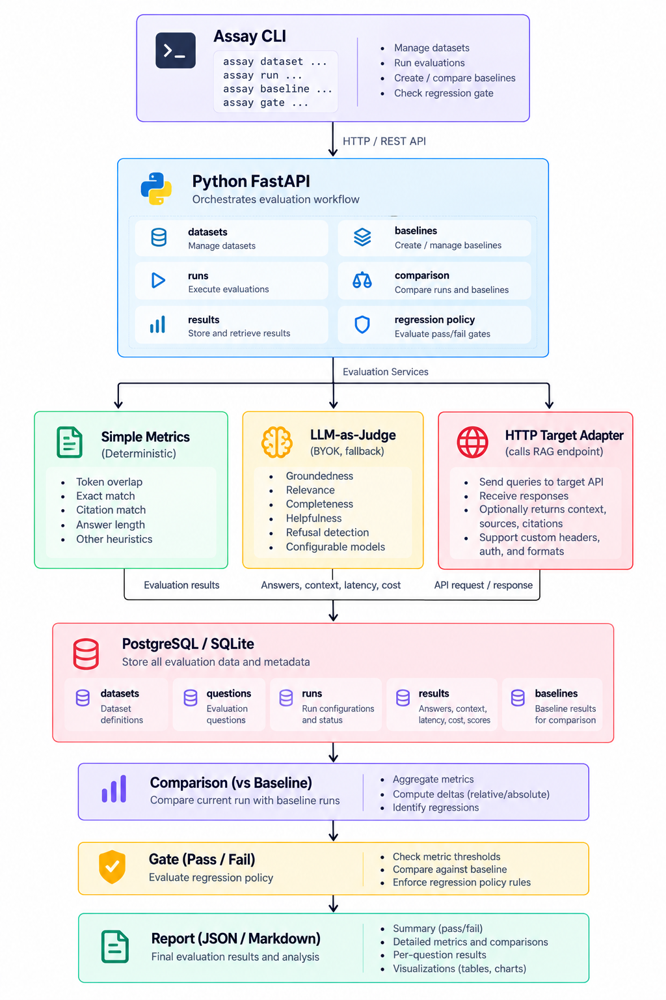

<p align="center">
  
</p>

<h1 align="center">Assay</h1>

<p align="center"><em>The CI gate for RAG quality regressions.</em></p>

<p align="center">
  <a href="https://github.com/gigihsusetyo/assay/actions/workflows/tests.yml"></a>
  <a href="https://opensource.org/licenses/Apache-2.0"></a>
  <a href="https://assay.web.id"></a>
</p>

---

Run your production-like RAG against a golden dataset, compare it with a pinned baseline, and fail the build when quality, latency, or cost regress beyond your policy.

If you have ever changed an embedding model, updated a knowledge base, swapped an LLM provider, or tuned chunking and wondered whether the system got better or worse, Assay is for you. It answers one question: did my latest change make things worse?

---

## The Problem

Every time you change something in a RAG system, you face the same question: did this make things better or worse?

Most teams answer this with manual spot checks. Test ten questions. Decide it looks fine. Deploy. Two days later, support tickets spike. The chatbot is giving wrong answers to technical questions. Rollback. The cost problem you were trying to solve is still there.

This is not a tooling problem. It is a decision problem. You need a way to know, before you deploy, whether the change is safe.

Assay is that way.

---

## What Assay Does

1. Takes a dataset of questions with expected answers and contexts.
2. Calls your RAG endpoint for each question.
3. Computes quality metrics (groundedness, answer relevance, context recall, citation accuracy, refusal correctness) and operational metrics (latency, cost).
4. Compares the results against a baseline.
5. Fails with a non-zero exit code if quality regresses beyond a threshold.

That last step is the point. Assay is not a dashboard. It is a gate.

---

## A Scenario

A SaaS company runs a support chatbot over its documentation. The team wants to swap the embedding model to cut costs.

Without Assay, they change the model in staging, test ten questions manually, and deploy. Two days later, support tickets spike by 40 percent. The chatbot is giving wrong answers to technical questions. They roll back in a panic.

With Assay, they have a golden dataset: 200 real questions with verified answers. They open a pull request that swaps the model. GitHub Actions runs Assay automatically. Assay calls the staging endpoint, compares against the baseline, and produces a report.

```
Assay Report: PR #247
Config: bge-m3 vs text-embedding-3-small

Groundedness        -8.2%   FAIL (threshold -5%)
Answer Relevance    -1.4%   PASS
Context Recall      -3.1%   PASS
P95 Latency         -18%    PASS (better)
Cost per query      -64%    PASS (better)

Verdict: FAILED
Reason: Groundedness dropped below threshold.
Worst failures (7 queries):
  "How do I configure SSO with Okta?"     (groundedness 0.42)
  "What is the rate limit for API v2?"    (groundedness 0.51)
```

The team sees that the new model struggles with exact-match technical terms. They add hybrid search to handle those cases. They rerun Assay. Groundedness improves to -2.1 percent. PASS. They deploy. Costs drop 64 percent. Quality holds.

The team avoided a production incident. They made a decision based on data, not feeling. They have a record of every change and its impact.

---

## What Assay Is Not

- Not a RAG framework. It does not build retrieval, chunking, or embedding pipelines.
- Not a metrics library. It integrates with existing ones like Ragas and DeepEval.
- Not an observability platform. Tracing and dashboards are on the roadmap.
- Not a general LLM evaluation tool. RAG is the first workload.

Assay evaluates RAG systems. It does not become one.

---

## Status

Early development. The core pipeline works end to end, and the project is deployed for demonstration. It is not yet ready for production use.

What works today:

- Create datasets and add questions via CLI or API.
- Import datasets from JSON files.
- Create runs pointing at a RAG endpoint.
- Execute runs: Assay calls the endpoint for each question and stores results.
- Compute groundedness and context recall with simple heuristics.
- Use LLM-as-judge for groundedness and answer relevance (BYOK).
- Compute citation accuracy for legal and regulatory answers.
- Compute refusal correctness (deterministic).
- Multi-provider fallback for resilience.
- Compare providers on the same calibration set.
- Validate the judge against human labels (Cohen's kappa).
- Probe for position, verbosity, and self-preference bias.
- Compare a run against a pinned baseline.
- Gate: fail with exit code 1 if quality regresses.
- Live demo deployed on Render.

What is not done yet:

- Integration with Ragas or DeepEval.
- Real Kubernetes deployment.

---

## Quickstart

Assay runs on Python 3.11.

```bash
git clone https://github.com/gigihsusetyo/assay.git
cd assay
python3.11 -m venv .venv
source .venv/bin/activate
pip install -e ".[dev]"
```

Create a dataset manually:

```bash
assay dataset create support-faq --description "Customer support FAQ"
```

Add a question:

```bash
assay dataset add-question 1 \
  --question "How do I reset my password?" \
  --answer "Go to settings and click reset." \
  --context "You can reset your password in settings."
```

Or import a dataset from a JSON file:

```bash
assay dataset import examples/datasets/indonesian-legal-rag.json
```

The repo ships with a sample dataset of 10 questions from Indonesian legal regulations. It comes from [wahyyuht/skripsi-data](https://huggingface.co/datasets/wahyyuht/skripsi-data) on Hugging Face, under CC BY 4.0.

Create a run pointing at your RAG endpoint:

```bash
assay run create --dataset 2 --name run-001 --target http://localhost:9000/query
```

Execute the run:

```bash
assay run execute 1 --verbose
```

With LLM-as-judge:

```bash
assay run execute 1 --verbose --judge
```

Pin the run as a baseline:

```bash
assay baseline create --name baseline-v1 --run 1 --description "First baseline"
```

List baselines:

```bash
assay baseline list
```

Compare a new run against the baseline:

```bash
assay gate --baseline baseline-v1 --run 2 --policy examples/policy.yaml
```

If the run passes, exit code is 0. If it fails, exit code is 1. If something is wrong with the input, exit code is 2.

---

## The Target Adapter Contract

Assay does not care what is inside your RAG system. It calls a standard HTTP endpoint and expects a standard response.

Request:

```json
{
  "question": "How do I configure SSO with Okta?",
  "dataset_id": "support-golden-v3",
  "run_id": "run_2026_09_29_001"
}
```

Response:

```json
{
  "answer": "To configure SSO with Okta...",
  "retrieved_contexts": [
    {"text": "...", "source": "docs/sso.md", "score": 0.87}
  ],
  "latency_ms": 1240,
  "cost_usd": 0.0032,
  "metadata": {"model": "gpt-4", "embedding": "text-embedding-3-small"}
}
```

Any RAG system that implements this contract can be evaluated.

---

## The Regression Policy

A policy is a YAML file that defines acceptable regression thresholds.

```yaml
version: 1
thresholds:
  groundedness: 5.0
  answer_relevance: 5.0
  context_recall: 5.0
  citation_accuracy: 5.0
  refusal_correctness: 5.0
  p95_latency_ms: 20.0
  avg_cost_usd: 20.0
```

Numbers are percentages. For quality metrics, the threshold is the maximum allowed drop. For latency and cost, the threshold is the maximum allowed increase.

Policy can use relative or absolute thresholds:

```yaml
version: 1
thresholds:
  groundedness:
    value: 5.0
    type: relative
  context_recall:
    value: 0.05
    type: absolute
```

---

## Metrics

### Quality Metrics

**Groundedness** measures whether the answer is supported by the retrieved contexts. With LLM-as-judge, the answer is decomposed into atomic claims, and each claim is verified against the contexts.

**Answer relevance** measures whether the answer addresses the question. With LLM-as-judge, the question is decomposed into atomic aspects, and each aspect is checked.

**Context recall** measures how much of the expected context was retrieved. It is deterministic.

**Citation accuracy** measures whether the citations in the answer (Pasal 5, UU 16/2025, etc.) actually exist in the retrieved contexts. It is deterministic. In legal and regulatory domains, an answer with the wrong citation is worse than an answer that admits uncertainty.

**Refusal correctness** measures whether the system refuses when it should refuse, and answers when it should answer. A question with an expected answer is answerable; a question without is not. It is deterministic. A RAG system that always answers — even when the contexts do not contain the answer — is dangerous without this metric.

For the MVP, simple heuristic metrics are also available. These are token overlap based. They are fast, deterministic, and free, but shallow. They catch obvious drift, not semantic errors.

### Operational Metrics

**P95 latency**, **average cost per query**, **P50 latency**, and **cost per successful answer** are tracked.

### Important: Regression Signals, Not Correctness Guarantees

Token overlap metrics catch obvious drift. They do not catch semantic errors. An answer that says "rate limit is 1000" when the context says "rate limit is 100" will score high on token overlap, because most tokens overlap. That is a real limitation.

For semantic correctness, use LLM-as-judge. Assay supports it via Bring Your Own Key (BYOK). See ADR-004 for details.

The point of these metrics is not to tell you whether your RAG is good. It is to tell you whether your latest change made it worse.

---

## Multi-Dimensional Evaluation

Assay measures more than one dimension. This is deliberate.

A system that always answers "I do not know" is perfectly grounded and completely useless. Groundedness alone does not catch that. Answer relevance does.

A system that answers the question but ignores the retrieved context is relevant and ungrounded. Answer relevance alone does not catch that. Groundedness does.

No single metric certifies a RAG system. The combination does.

---

## Judge Validation

Assay validates the LLM judge before trusting it.

- **Calibration set**: 250 manually reviewed entries from 60+ Indonesian legal documents.
- **Adversarial suite**: 20 cases across 20 categories (number mutation, negation, modality, quantifier, condition dropped, refusal, multi-context, conflicting contexts, prompt injection, entity swap, paraphrase, cross-lingual, hedging). 17/20 pass on the current prompt.
- **Bias probes**: position bias, verbosity bias, self-preference bias.

Run validation:

```bash
python scripts/validate_judge.py examples/calibration_set_reviewed.json
```

Run adversarial suite:

```bash
python scripts/run_adversarial_suite.py examples/adversarial_suite.json
```

If the judge is not reliable, do not trust its scores. Better to know than to guess.

---

## Judge Reliability

The judge is not assumed to be correct. It is measured.

On the 250-entry calibration set (Indonesian legal domain, manually
reviewed without seeing the judge prediction), the current prompt
achieves:

| Metric | Value |
|---|---|
| Cohen's kappa | **0.899** |
| Raw agreement | 95.6% |
| True positives | 165 |
| True negatives | 74 |
| False positives | 4 |
| False negatives | 7 |

Kappa 0.899 is **EXCELLENT** on the standard interpretation scale.
The judge is reliable for this domain. It is not perfect: 11 of 250
entries (4.4%) are still misclassified, and 3 adversarial edge cases
fail. These are documented in ADR-004.

### The Framework Is Universal. The Judge Is Domain-Specific.

Assay ships with a legal Indonesia calibration set as a **reference**.
It is not a universal calibration. A judge calibrated for legal
Indonesia may not be reliable for medical, financial, or technical
content, where the material qualifiers are different.

**For your own domain, calibrate the judge yourself.** The toolkit is
included:

```bash
# 1. Split your calibration set into review batches
python scripts/review_split_txt.py --input examples/calibration_set.json

# 2. Review each batch in a text editor, fill in the HUMAN field
#    (see review/PANDUAN.txt for the rules)

# 3. Parse reviewed batches into a JSON calibration set
python scripts/review_parse_txt.py

# 4. Validate the judge
python scripts/validate_judge.py examples/calibration_set_reviewed.json
```

If kappa is below 0.6, the judge is not reliable for your domain.
Fix the prompt, change the model, or expand the calibration set before
using Assay as a CI gate.

See ADR-006 for the full rationale.

### Known Limitations

At kappa 0.899, 11 of 250 calibration entries are still misclassified,
and 3 of 20 adversarial cases fail:

- **Cross-lingual**: The judge does not always recognize a translation
  as a paraphrase (e.g., Indonesian context, English answer).
- **Multi-context**: The judge does not always combine facts from two
  contexts to support a claim.
- **Condition dropped**: The judge returns "unsupported" instead of
  "contradicted" when an exception is dropped.

These are edge cases, not the common case. The trade-off is documented
in ADR-004. A stronger model or a split prompt (core + domain overlay)
may address them in the future.

---

### Answer Relevance Validation

On the balanced 100-entry challenge set (50 positive, 50 hard
negative), the judge achieves:

| Metric | Value |
|---|---|
| Cohen's kappa | **0.920** |
| Raw agreement | 96.0% |
| Balanced accuracy | 96.0% |
| Sensitivity | 100.0% |
| Specificity | 92.0% |

Kappa 0.920 is EXCELLENT. The judge is reliable for this domain.

The four false positives are all cases where the judge marked an
answer as relevant when it should not have: wrong entity with the
same topic, vague refusal, and partial answer that addresses a
different aspect. These are documented in ADR-004 as known
limitations.

**The relevance metric is validated for this domain.** It should be
treated as reliable for discriminating relevant from irrelevant
answers. For domains other than legal Indonesia, calibrate the judge
yourself with a balanced set built from your own data.

---

## Provider Configuration

Assay does not provide an LLM. You bring your own (BYOK). Any OpenAI-compatible API works. Configure one or more providers:

```
ASSAY_JUDGE_PROVIDER=groq
ASSAY_JUDGE_MODEL=openai/gpt-oss-120b
ASSAY_JUDGE_API_KEY=gsk_...
ASSAY_JUDGE_BASE_URL=https://api.groq.com/openai/v1

ASSAY_JUDGE_PROVIDER_2=gemini
ASSAY_JUDGE_MODEL_2=gemma-4-26b-a4b-it
ASSAY_JUDGE_API_KEY_2=AQ...
ASSAY_JUDGE_BASE_URL_2=https://generativelanguage.googleapis.com/v1beta/openai/
```

When the primary provider fails with a transient error (rate limit, timeout, connection error, server error), Assay falls back to the next provider in the list. If all providers fail, the judge returns an error.

Fallback is enabled by default. Set `ASSAY_JUDGE_FALLBACK=false` to disable it. When disabled, only the first provider is used.

Different providers may give different judgments. For a CI gate that needs strict consistency, either use a single provider or set `ASSAY_JUDGE_FALLBACK=false`.

Gemini uses a different authentication scheme. Assay handles it via the google-genai SDK.

### Comparing Providers

To compare providers on your own calibration set:

```bash
python scripts/compare_judges.py examples/calibration_set.json
```

This runs the judge with each configured provider and reports agreement, Cohen's kappa, and error count. Use it to decide which provider is best for your data.

---

## Architecture

<p align="center">
  
</p>

SQLite is the default for local development. PostgreSQL is the target for production. Assay is tested with Supabase as a managed PostgreSQL provider.

---

## Roadmap

**Phase 1 — Trust:**
Golden datasets, baselines, regression policies, CLI, CI gate, JSON output, PR comments, judge validation, adversarial suite, multi-provider fallback.

**Phase 2 — Quality and Scale:**
Ragas integration. Multi-domain calibration. Hold-out test set. Timeout handling. Consistency test.

**Phase 3 — Deployment and Observability:**
Kubernetes deployment with k3s. OpenTelemetry traces. Historical regressions. Alerts. Dashboards.

A hosted, multi-tenant version is on the longer-term roadmap. The core stays open source.

---

## Development

Assay runs on Python 3.11. The recommended development setup:

1. Clone the repository.
2. Create a virtual environment: `python3.11 -m venv .venv`.
3. Activate it: `source .venv/bin/activate`.
4. Install dependencies: `pip install -e ".[dev]"`.
5. Create a `.env` file with your database URL and judge provider. See `.env.example` for the format.
6. Run tests: `pytest tests/ -v`.

### Database

For local development, SQLite works out of the box. Set the default in `.env`:

```
ASSAY_DATABASE_URL=sqlite:///./assay.db
```

For production, PostgreSQL is the target. Assay is tested with [Supabase](https://supabase.com) as a managed PostgreSQL provider. Use the Session Pooler connection string, not the direct connection, because the direct connection is IPv6-only and may not work from all networks.

### Running the services

Run the API:

```bash
uvicorn assay.main:app --host 0.0.0.0 --port 8000
```

Run the mock RAG for testing:

```bash
python -m uvicorn examples.mock_rag.app:app --host 0.0.0.0 --port 9000
```

### Docker

A Dockerfile is included. To build:

```bash
docker build -t assay:dev .
```

Note: Docker Desktop 4.15.0 is the last version that runs on macOS Catalina. On newer systems, any recent Docker version works.

---

## Optional Extras

Assay ships with a small core. Some features are available as extras.

### Ragas integration

To use Ragas metrics (faithfulness, answer relevancy, context
precision, context recall) as part of an Assay run, install the
`ragas` extra:

```bash
pip install "assay[ragas]"
```

Then run:

```bash
assay run execute <run_id> --ragas
```

Note: `ragas` pulls in LangChain, `pyarrow`, and `libcst`. On some
systems (notably macOS without Rust), `pip` may attempt to build
`pyarrow` from source and fail. If so, install a Rust toolchain, or
use a system where prebuilt wheels are available. This is a
limitation of the Ragas ecosystem, not Assay. Assay itself remains
lightweight and does not require these dependencies.

When Ragas is not installed, `--ragas` is silently skipped. Assay
continues to run with the core metrics (groundedness, relevance,
completeness, context recall, citation accuracy, refusal
correctness).

---

## License

Apache 2.0. See [LICENSE](LICENSE).

---

## Links

- Live demo: [assay-6pji.onrender.com](https://assay-6pji.onrender.com)
- API docs: [assay-6pji.onrender.com/docs](https://assay-6pji.onrender.com/docs)
- Domain: [assay.web.id](https://assay.web.id)
- GitHub: [github.com/gigihsusetyo/assay](https://github.com/gigihsusetyo/assay)